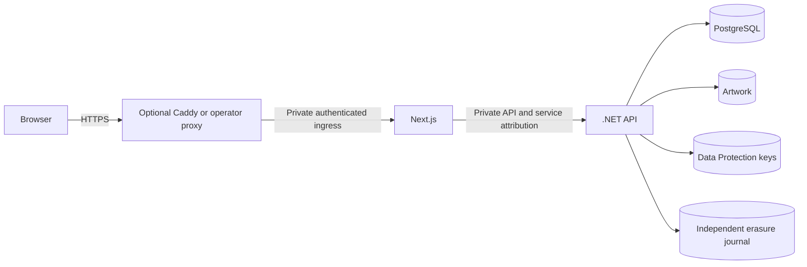

# Self-hosted reference installation

Status: Approved by the project owner, 2026-11-10. Product direction is accepted in
[ADR 0020](../../adr/0020-self-hosted-open-source-distribution.md); detailed
packaging choices below are the author's recommendations. No application or
container implementation is included in this design task.

Builder review completed 2026-11-10 with no material gaps identified. The owner
subsequently approved this design. Implementation verification remains pending.

## Intent and scope

An operator should be able to install RateFreak on their own Linux host without
a Vercel account, developer SDKs, development user-secrets or mandatory external
sign-in/provider accounts. Deliver a reproducible production reference topology,
explicit initialization/upgrade tools and a practical operator guide. Keep the
existing browser → Next.js proxy → .NET API → PostgreSQL architecture.

The initial verified target is Linux amd64 with Docker Engine and Compose v2,
one instance of each application service, and a dedicated hostname at the site
root. Exact minimum Docker/Compose versions and resource requirements will be
published from implementation/acceptance results, not guessed here. Other hosts
can use the same service/configuration contracts; arm64, subpath installations,
multiple replicas and arbitrary proxy/CDN chains are not initially verified.
None of those limitations makes a vendor account a dependency.

## Approaches considered

| Approach | Benefit | Cost |
| --- | --- | --- |
| Compose services plus optional bundled Caddy | Complete HTTPS starting point with an escape hatch for existing proxies | Maintain images, Compose, initialization and two ingress examples |
| Compose requiring an operator-supplied proxy | Smaller bundle | Every fresh installation must solve ingress before using the app |
| Native Node/.NET/PostgreSQL installation only | Maximum control without containers | Larger initial installation and platform support burden |

Recommend the first approach. Existing proxy use is part of the configuration
contract, not a promise to verify every proxy product. Native installation can
follow the documented contracts without becoming a second release packaging task.

## Topology and public surface

Compose base services have no published ports. A bundled-ingress override adds
Caddy on 80/443 and persistent certificate storage. Dedicated networks connect
edge↔web, web↔API and API↔database; database credentials go only to API/maintenance
services. Keep application outbound connectivity for optional providers/OAuth;
network segmentation must not inadvertently disable their egress. Do not mount
the Docker socket. Unrelated containers must not join these networks.

The edge sends every application path, including `/api/v1` and OAuth callbacks,
to Next.js. Never route public `/api` traffic directly to .NET. API and database
listeners, private health endpoints, artwork, keys and journal are not publicly
published. Preserve streaming, cancellation, separate Set-Cookie headers and
no-store responses. Retain the existing route/body/time budgets; configure the
edge to allow bounded image uploads and five-minute account export streams.

Public DNS with suitable ports and persistent certificate storage is the default
Caddy path. LAN/local verification uses an explicitly trusted local CA or operator
certificate; do not weaken production Secure cookies or turn off certificate
validation. See [Caddy automatic HTTPS](https://caddyserver.com/docs/automatic-https).

For an existing host proxy, an override may publish Next.js on loopback only.
For a containerized proxy, attach only the dedicated ingress network. Direct
public Next.js ports are unsupported. A remote proxy requires firewall restriction
and TLS on its upstream link; the single-host reference may use private HTTP.

## Portable ingress trust

Keep the existing API attribution secret and current Vercel adapter. Add a
`trusted-proxy` client-IP mode for self-hosting; it is distinct from Development
`loopback` mode. Proposed settings and headers are new contracts, not existing
working configuration:

| Hop | Secret/configuration | Behavior |
| --- | --- | --- |
| Edge → Next.js | `RATEFREAK_INGRESS_SECRET`, 64 random hex characters | Edge overwrites `X-RateFreak-Ingress-Key` and `X-RateFreak-Ingress-IP` on each forwarded request |
| Next.js → API | Existing `RATEFREAK_PROXY_SECRET` / `BrowserProxy__SharedSecret` | Next constructs the existing API service key and normalized client-IP headers |

Use independent ingress/API secrets. The direct-edge example derives its address
from the actual socket peer, never a browser-supplied forwarding header. An
operator using an upstream CDN/proxy must explicitly configure trusted upstreams
and demonstrate real-client address parsing; do not accept all private networks
or arbitrary X-Forwarded-For chains as proof of identity. Caddy supports explicit
header replacement; see its [reverse-proxy contract](https://caddyserver.com/docs/caddyfile/directives/reverse_proxy).

Next validates the ingress key with constant-time comparison and requires one
valid IPv4/IPv6 literal. Missing, malformed, duplicate/combined or invalid ingress
headers fail closed on every browser API/proxy path, including OAuth and setup.
Invalid requests must not reach the API. Never fall back to a caller's
X-Forwarded-For, API service key, Vercel header or a shared loopback budget.

Next does not forward ingress credentials to the API or browser. It reconstructs
API attribution from validated input; the API's current constant-time service-key
validation and independent account authorization remain in force. Client address
attribution controls abuse budgets, not the user's role or session identity.
The fixed public origin remains authoritative for writes and external callbacks;
arbitrary Host/forwarded-proto headers must not establish it.

Configuration validation allows private HTTP API upstreams in `trusted-proxy`
mode only as an explicit documented single-host trust boundary. Require HTTPS
for cross-host application links. Preserve current Vercel and Development rules.
The adapter must be shared by all existing proxy handlers so no alternate
export/upload/OAuth route accidentally bypasses it.

## Images and release artifacts

Use multi-stage builds: .NET 10 SDK → ASP.NET runtime for the API, Node 24/pinned
pnpm → Next.js standalone output for the web. Include standalone static/public
assets. Read the installed Next documentation before changing build settings.
Run application processes without root, test SkiaSharp decoding on the supported
architecture and keep writable temporary/export/cache locations explicit.

Ship source-build Compose support first. A tagged release should pair matching
web/API images, migration artifacts, Compose templates and instructions under a
single release version, with recorded image digests and verification revision.
Registry/namespace selection and publishing require separate authorization;
neither `latest` tags nor CI publication is assumed by this design.

Exclude `.env`, developer keys, `.local`, backups, databases, build caches and
unrelated workspace files from image build contexts. Confirm runtime server
configuration can change between installations without rebuilding browser assets.
No credentials or deployment origins belong in `NEXT_PUBLIC_` variables.

## Configuration and persistent data

Expose an instance hostname/public HTTPS origin and optional provider settings.
Use protected per-instance configuration/secret files, generated independently on
first setup. Container entrypoints may translate mounted secrets to the existing
environment-variable contracts; do not log them, place them in command arguments
or assume unimplemented `_FILE` application options already work. Supply secrets
only to the services that need them. Explain host-admin access and file permissions.

| Data | Mount/access | Recovery contract |
| --- | --- | --- |
| PostgreSQL | Database service; protected persistent volume | Coordinated backup with artwork |
| Artwork | API and authorized maintenance only; outside static roots | Matching database point; access remains through API |
| Data Protection keys | API; private directory | Preserve through restart/upgrade; recover with matching instance identity |
| Erasure journal | API and replay; private directory, mode-0600 file | Independent append-preserving replication; never replaced by an old ordinary backup |
| Caddy certificates | Edge only | Persistent certificate state; follow proxy's recovery guidance |
| Operator records | Operator-managed protected store | Named attribution and 365-day expiration per staff policy |

Separate volume names are useful isolation, but are not independent off-host
backup or encryption. Require an operator-protected/encrypted host/storage layer
for keys, credentials and backups, and document external journal replication before
account deletion is offered. Replication failure/recovery monitoring remains an
operator duty; provisioning a file alone does not prove the policy is satisfied.

PostgreSQL bootstrap uses separate migration/owner and least-privilege runtime
credentials. The runtime has required schema usage and application DML rights,
including future-table default grants, but no schema ownership or DDL. Maintenance
receives only required privileges; migrations use the migration identity. Test
every grant against setup, retention, erasure and future migrations. Never use a
superuser API credential merely because PostgreSQL's container initializes one.

Google/GitHub sign-in and catalog metadata providers default off. The app remains
usable with local accounts and custom items. Enabling a provider requires the
operator's own credentials/contact details, callback registration and relevant
terms/attribution acceptance; no shared project credentials are distributed.

## Installation and startup

Provide an initialization command and a start command, not an unexplained
`compose up` that mutates databases. The implementation will document their exact
syntax once verified.

1. Operator obtains a versioned package, configures public hostname/HTTPS mode and
   creates private instance configuration. Initialization exclusively creates
   missing secrets and validates existing values without rotating them implicitly.
2. Prepare volume ownership and the journal using an explicit one-shot utility.
   Exclusively create/fsync a new journal and parent directory. An existing journal
   is validated and preserved; conflicts, symlinks, wrong permissions or unexpected
   files stop initialization rather than truncate or chmod unknown data.
3. Start PostgreSQL and wait for readiness. Create runtime/migration roles for a
   fresh installation; existing-database credentials/ownership require explicit
   operator configuration rather than automatic takeover.
4. Run the matching explicit migration artifact offline using the migration
   identity. Proposed packaging is an EF migration bundle built with the release;
   verify its configuration and failure behavior during implementation.
5. Start API and Next.js only after successful initialization/migration; then edge.
   API readiness includes schema checks. A frontend health probe must not require
   a publicly reachable unauthenticated maintenance endpoint or leak configuration.
6. Open `/setup` over HTTPS and use the private API-only setup secret to create
   the first Admin and save recovery material. Subsequent registration stays
   unprivileged; setup never reopens on upgrade or staff removal. Remove the
   deployment setup secret after completion as a documented operator step.

Normal app restarts do not migrate, replay erasures or regenerate credentials.
Initialization is repeatable without data loss; migration failure stops application
startup. Compose dependencies help ordering but are not evidence that an upgrade
is safe while old writers are active.

## Upgrade, backup and recovery

Before upgrade, record the current revision/schema and take a protected coordinated
database/artwork backup while all API/jobs/writers are stopped. Keep key recovery
material protected and the independent journal current. Review migration notes,
run the explicit new migration artifact, then start matching new API/web images
and perform acceptance checks. Do not use `down -v`, discard live data or silently
roll back an irreversible migration. On failure keep writers stopped and follow
the reviewed matching-version recovery procedure.

Provide documented backup and isolated-restore commands using packaged tools, not
a developer SDK. Validate database dump/archive integrity, record hashes/version
and verify referenced artwork. Every restorable database/artwork copy expires
within the current 30-day policy; archive versions and remote replicas count.
Operators choose destination, encryption, schedule and recovery objectives, then
verify them. A local backup directory is not protection from host loss.

Restore matching database/artwork/application/key material to an isolated target
with all writers stopped. Keep the current independent journal. Run the existing
Release erasure replay command with explicit database name and confirmation,
verify removed accounts/private content/artwork, retained public content/moderation,
cleanup and idempotency, then decide whether to reopen traffic. Pending intents
are replayed too. Never publish a restored database before replay succeeds.

## Verification and acceptance

The reference implementation is accepted only with recorded evidence for:

- Clean installation from versioned artifacts on the supported architecture with
  no developer secrets/SDK; setup/registration and optional-provider-disabled use.
- Ingress key/address validation across ordinary requests, setup, uploads,
  exports and OAuth; malformed/combined inputs, forged headers and direct-port
  access cannot spoof attribution. Distinct clients receive distinct budgets.
- Real HTTPS browser session, CSRF/Origin denial, logout/recovery, export streaming
  and cancellation, image upload and private-content/no-store handling.
- No API/database/health/private files publicly reachable; stable behavior after
  container restart/recreation and retained sessions/keys/artwork/journal.
- Non-root application processes, private mount permissions, least-privilege
  runtime database credentials and credential exclusion from images/logs/bundles.
- An existing supported database upgrade preserving data, a deliberate migration
  failure preventing startup, repeat initialization preserving existing secrets
  and journal, and mismatched configuration refusing safely.
- A packaged coordinated backup/isolated restore with subsequent account deletion,
  pending/completed erasure replay, exact-database refusal and repeated replay.
- Staff access and offline Admin appointment/removal/recovery with last-Admin
  protection, named operator correlation and sanitized records.

CI should run focused adapter tests plus relevant API tests, image builds and
disposable Compose smoke checks. HTTPS/browser/recovery evidence must explicitly
state its topology and source revision. Do not mark untested arm64, multi-replica,
CDN or remote-proxy setups supported based solely on successful image compilation.

## Follow-on implementation slices

1. Portable ingress adapter and spoofing/failure regression coverage.
2. API/web images, secret/volume initialization and explicit migration packaging.
3. Base Compose plus optional Caddy and operator-proxy configuration contracts.
4. Installation/upgrade/recovery guide and clean-host/HTTPS/restore acceptance.

License choice, registry ownership, public publishing and contribution/security
policy remain separate release tasks. No choice of commercial host is required.
